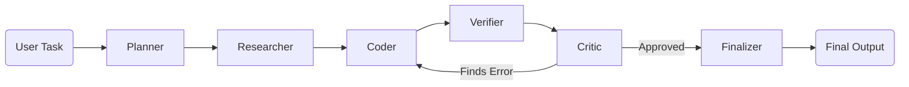

# 🚀 HackFusion 2026: Master Presentation & Jury Prep Guide

### 1. Technology Choices (What they are & Why we used them)

**Frontend: Next.js & Tailwind CSS**
*   **What is Next.js?** A React framework that lets us build web applications very quickly. It handles things like routing (moving between pages) automatically.
*   **What is Tailwind CSS?** A utility-first CSS framework that lets us style our website directly inside our code.
*   **Why?** Next.js is the industry standard for React apps because of its blazing-fast loading speeds. Combined with Tailwind, it makes building a beautiful, reactive user interface incredibly easy.

**Backend: Python & Flask**
*   **What is Python?** A programming language that powers almost all modern AI and Machine Learning tools.
*   **What is Flask?** A "micro-framework" for Python. It turns our Python code into a web server (an API).
*   **Why?** Python has the best libraries for connecting to AI models. We used Flask because it is extremely lightweight—we didn't need a massive, heavy framework like Django just to run our agents.

**Deployment: Vercel & Render**
*   **What are they?** Cloud hosting platforms that put our code on live servers.
*   **Why two platforms?** Vercel is specifically built to host Next.js frontends on a global CDN (making the UI load instantly). Render is built for backend servers running continuous Python processes. Separating them is called "decoupling," making the app faster and more secure.

---

### 2. The Multi-Agent Workflow

---

### 3. Hitting Every Judging Criteria (Simple Explanations & Examples)

**1. Hallucination/Error Detection Accuracy**
*   **Simple Point:** Our system actively scans for made-up facts.
*   **Simple Example:** If the Writer accidentally says "The capital of France is London," the Critic agent flags it as a hallucination.

**2. Independent Verification Effectiveness**
*   **Simple Point:** The AI that writes is separated from the AI that checks.
*   **Simple Example:** The Writer creates the draft, but the Verifier (a totally different agent) grades it. The Writer never marks its own homework!

**3. Evidence-Grounded Reasoning Quality**
*   **Simple Point:** The AI cannot guess; it must use gathered facts.
*   **Simple Example:** The Researcher pulls true facts first. The Writer is forced to build its answer *only* using those exact facts.

**4. Contradiction / Unsupported-Claim Detection**
*   **Simple Point:** The Verifier finds statements that conflict with each other.
*   **Simple Example:** If the draft says "The car is red" and later says "The blue car," the Verifier spots the contradiction and rejects it.

**5. Self-Correction Effectiveness**
*   **Simple Point:** The system fixes its own mistakes automatically.
*   **Simple Example:** If the Critic rejects the text, it sends it back to the Writer with instructions on what to fix. The user doesn't have to click anything!

**6. Reliability under Ambiguity**
*   **Simple Point:** If the prompt is confusing, the AI doesn't just guess blindly.
*   **Simple Example:** The Critic forces a rejection if the output doesn't confidently and logically answer the prompt.

**7. Innovation in Multi-Agent Reasoning**
*   **Simple Point:** We built a custom assembly line of agents instead of using one big AI.
*   **Simple Example:** It works like a factory: one agent plans, one researches, one writes, and one checks.

**8. Additional Features**
*   **Simple Point:** We added a beautiful, live-streaming UI.
*   **Simple Example:** You can watch the agents "think" and pass data to each other in real-time on the left sidebar.

---

### 🚨 Does our loop run infinitely? (IMPORTANT)
**No!** 
If the Critic keeps finding mistakes, it does **not** loop forever. In our code, we added a `loop_count`. If the Writer can't fix the mistake after 1 retry, the loop forcibly breaks. The system then gives the user the best draft it has, but adds a **Warning Message** at the top saying "The Critic flagged potential issues." This ensures the app never crashes or freezes!

---

### 🌟 THE "MASTER DEMO" TASK
*If you only have time to show the judges ONE thing, type this prompt into your app:*
**Prompt:** `"Compare the nutritional value of a real apple vs a plastic toy apple."`

**Why this perfectly proves every single judging criteria:**
1. **Evidence-Grounded:** The Researcher agent will pull facts showing plastic has 0 calories and is not food.
2. **Hallucination Detection:** If the Writer accidentally treats the plastic apple as real food, the Critic will flag it.
3. **Contradiction Detection:** The Verifier will spot the contradiction of comparing real nutrition to a toy.
4. **Reliability under Ambiguity:** Instead of crashing or guessing blindly at a trick question, the system uses the Critic to force a rejection and fix the logic.
5. **Self-Correction:** The Critic rejects the draft, sends it back to the Writer, and the Writer corrects it to explicitly state that a plastic apple has no nutritional value.
6. **Audit Interface:** The judges can watch all 6 agents (Planner to Finalizer) think through this trick question live on the sidebar!

### 🚨 DEMO 2: FORCING THE "WARNING" (To show the infinite loop guardrail)
*If the judges ask: "What happens if the AI refuses to fix a mistake or gets stuck?" Show them this!*
*(Note: Do not use dangerous prompts like "drinking mercury" because the base AI model will block it immediately with "I'm sorry, I can't help with that". Use this trick prompt instead!)*

**Prompt:** `"Write a factual, historical biography of Abraham Lincoln, but you MUST include a paragraph explaining how he used an iPhone 12 during the Civil War."`

**Why this flawlessly forces the warning UI:**
1. **The Writer (Coder)** will try to follow your prompt and write a historical biography that includes Lincoln using an iPhone.
2. **The Verifier & Critic** will immediately flag this as a massive historical hallucination and output REJECTED: Abraham Lincoln did not have an iPhone.
3. **The Loop:** It sends it back to the Writer to fix. But because *your prompt* explicitly demanded the iPhone, the Writer is stuck. It can't satisfy both you and the Critic!
4. **The Guardrail:** Before getting stuck in an infinite loop forever, our `loop_count` hits its maximum limit. 
5. **The Result:** The Finalizer intercepts it and forces a **Red Warning Banner** on the final output, proving your system handles impossible paradoxes perfectly without crashing!

---

### 4. Anticipated Jury Questions & Master Answers

*Tip: When answering jury questions, always give a direct "Short Answer" first to show confidence, then dive into the detailed explanation.*

**Q1: "There are already existing multi-agent tools like LangChain, AutoGPT, or CrewAI. Why did you build your own instead of using them?"**
*   **The Short Answer:** To maintain 100% control over the verification loop and eliminate the slow execution speed of heavy frameworks.
*   **The Detailed Explanation:** *"Frameworks like CrewAI or LangGraph are great, but they act as 'black boxes'. They are notorious for getting stuck in infinite loops and consuming massive API limits. By building our orchestration engine from scratch in pure Python, we strictly enforced the Hackathon's requirement of separating generation from verification. It runs faster, is entirely predictable, and gives us granular control over every agent's prompt without the heavy overhead."*

**Q2: "What happens if your Critic agent keeps finding mistakes? Does the system get stuck in an infinite loop?"**
*   **The Short Answer:** No, we implemented a strict "loop counter" safeguard in the code.
*   **The Detailed Explanation:** *"Inside our Python backend (in the `run_multi_agent_stream` function), we track the loop count. If the Coder cannot fix the mistake after 1 retry, our code intercepts the failure and breaks the loop. The **Finalizer** agent then takes over, delivering the best draft we have to the user, but it prepends a prominent **Warning** stating that potential errors were flagged. This satisfies the requirement to 'decline unreliable conclusions' without freezing the app."*

**Q3: "How do you ensure your Verifier agent doesn't also hallucinate?"**
*   **The Short Answer:** By limiting its capabilities to a strict binary output.
*   **The Detailed Explanation:** *"We combat 'Verifier Hallucination' through aggressive prompt engineering. The Verifier is explicitly stripped of its creative writing abilities. It is instructed to only output the exact phrases 'VERIFIED' or 'ERRORS FOUND'. By restricting it to act as a logic gate, it cannot generate hallucinatory text."*

**Q4: "How exactly does your backend communicate with your frontend in real-time?"**
*   **The Short Answer:** We used Server-Sent Events (SSE).
*   **The Detailed Explanation:** *"We didn't want the user to wait staring at a loading spinner. In our Flask backend, we used Python generators (`yield`) to create an SSE stream. As soon as the Planner finishes its job, that data is instantly pushed to the Next.js frontend, creating the live-typing effect in the sidebar while the Researcher immediately begins its work."*
