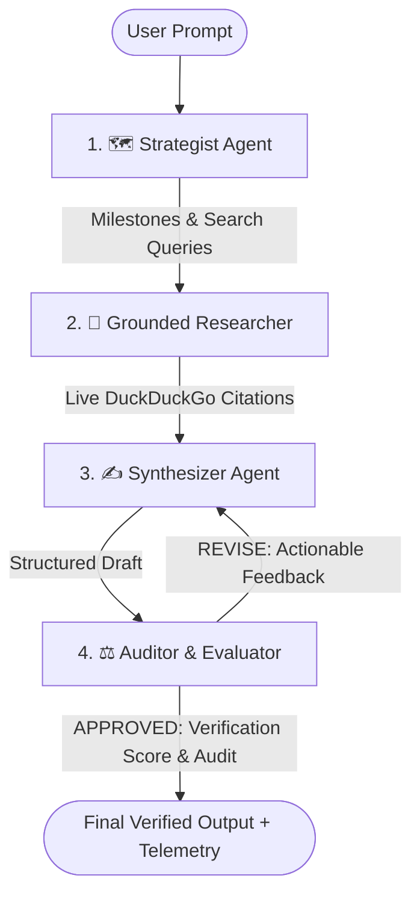

<div align="center">

# 🤖 VersatileAI
### Autonomous Multi-Agent Verification & Synthesis Platform

[](https://nextjs.org/)
[](https://python.org/)
[](https://groq.com/)
[](https://build.nvidia.com/)
[](https://docker.com/)
[](LICENSE)

**[🌐 Live Demo on Vercel](https://versatile-ai-delta.vercel.app/)** • **[⚡ Backend on Render](https://versatile-ai-backend.onrender.com)**

</div>

---

## 🌟 Overview

Single-agent LLMs frequently hallucinate facts and cannot verify their own output. **VersatileAI** solves this by orchestrating a distributed swarm of **4 specialized AI agents** that plan, ground in live web data, synthesize, and objectively audit responses before delivering the final result.

Every answer is **grounded in real-time DuckDuckGo web search results** with clickable source citations and evaluated through an automated **Auditor self-correction loop**.

---

## 🧠 Multi-Agent Pipeline Architecture



### Agent Roles:
1. **🗺️ Strategist Agent:** Decomposes complex queries into milestones and formulates targeted web search queries *(Groq Llama 3.1 8B)*.
2. **🔬 Grounded Researcher:** Queries live web data via DuckDuckGo, extracting verified snippets and source URLs.
3. **✍️ Synthesizer Agent:** Drafts comprehensive, structured responses citing web sources in clean Markdown *(Groq Llama 3.3 70B)*.
4. **⚖️ Auditor Agent:** Strict evaluator that checks facts against sources, detects logic flaws, scores quality (1–10), and triggers revisions if necessary *(NVIDIA Nemotron 70B)*.

---

## ⚡ Universal Free Multi-Model Gateway

VersatileAI is built with a dynamic **Model Router** that cascades across 100% free model providers with automatic failover:

| Provider | Model | Free Tier Details |
| :--- | :--- | :--- |
| **Groq Cloud** | `llama-3.3-70b-versatile` & `llama-3.1-8b-instant` | Blazing-fast sub-second LPU inference |
| **NVIDIA Direct NIM** | `nvidia/llama-3.1-nemotron-70b-instruct` | 1,000 free GPU credits on [build.nvidia.com](https://build.nvidia.com) |
| **OpenRouter** | Strictly `:free` models (`nemotron:free`, `llama-3.3:free`) | Zero pay-per-token risk |
| **Google Gemini** | `gemini-2.0-flash` | Free tier via Google AI Studio |

---

## 🚀 Quick Start (Local Development)

### Prerequisites
* Python 3.11+
* Node.js 18+

### 1. Clone & Set Up Backend
```bash
cd backend
pip install -r requirements.txt
```
Copy `.env.example` or create a `.env` file inside `backend/`:
```env
GROQ_API_KEY=gsk_your_groq_key
NVIDIA_API_KEY=nvapi_your_nvidia_key
OPENROUTER_API_KEY=sk-or-v1_your_openrouter_key
GEMINI_API_KEY=your_gemini_key
PORT=8000
```
Start the backend server:
```bash
python main.py
```
*API running at `http://localhost:8000`.*

### 2. Set Up Frontend
```bash
cd frontend
npm install
npm run dev
```
*Visit `http://localhost:3000`.*

---

## 🐳 Docker Deployment

Run both frontend and backend with a single command:
```bash
docker compose up --build
```

---

## 🧪 Running Automated Tests

Run the backend unit test suite:
```bash
cd backend
python -m unittest test_agent.py
```
*Tests cover model provider initialization, search tool fallbacks, agent state transitions, and infinite loop safeguards.*

---

## 📡 API Reference

### `POST /api/run-task`
Streams multi-agent reasoning events via Server-Sent Events (SSE).
* **Body:**
  ```json
  {
    "prompt": "Compare SQL vs NoSQL databases",
    "provider": "auto"
  }
  ```
* **Event Stream (`text/event-stream`):**
  * `status: "running"`: Real-time agent thought & latency.
  * `status: "completed"`: Final verified Markdown, Auditor score, and telemetry.

### `GET /api/providers`
Returns list of currently active model providers in the environment.

---

<div align="center">
Built with ❤️ for High-Reliability AI Verification
</div>
